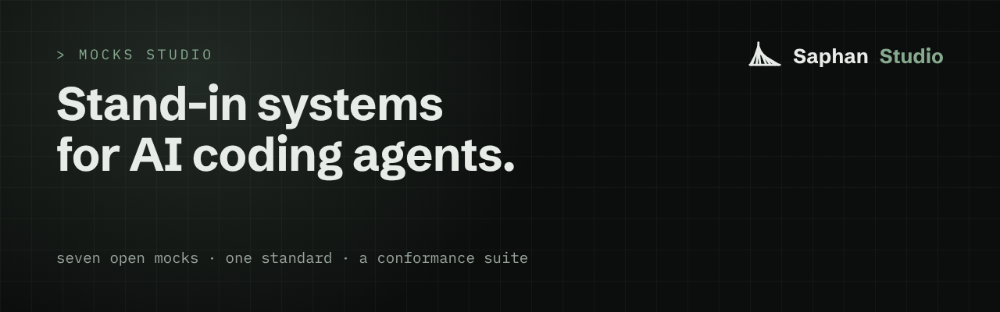

# Mocks Studio: stand-in systems for AI coding agents

<p align="center"></p>


**For teams whose AI agents, tests or skills need a mail server, a file store or a user directory to work against,
and must not touch the real one.** You do not need to know anything about Saphan to read this or to use this
repository.

A **mock** is a stand-in for a real system. It answers like the real thing, but nothing it does is real. This
repository holds a standard for building mocks, a test suite that checks a mock keeps to it, and seven free mocks.

## Try it first (5 minutes)

You need [Go](https://go.dev/) 1.26 or newer, `git`, `curl` and three terminals. The mock here stands in for a small
part of the Kubernetes API, the system many teams use to run their software.

Four words, so the commands make sense. A **run** is one piece of work, such as one test run. The mock keeps every
run apart: its own address, its own data. The **control address** is where you tell the mock to open a run or change
its behaviour. An **event** is the mock's record of one thing that happened.

**Terminal 1.** Start the mock. It keeps running; stop it with Ctrl+C.

```
git clone https://github.com/saphan-ai/mocks-studio
cd mocks-studio
go -C mocks/kubernetes run ./cmd/kubernetes-mock serve --control 127.0.0.1:9100
```

**Terminal 2.** Check the mock against the standard. The suite runs about thirty checks and prints one line each,
`PASS`, `FAIL` or `SKIP`, then a `SUMMARY` line. It exits `0` when every check passed.

```
cd mocks-studio
go -C conformance run ./cmd/mocks-conformance --manifest ../mocks/kubernetes/mocks.manifest.json
```

Then, in the same terminal, watch what the mock records for a run called `my-first-run`:

```
curl -N 'http://127.0.0.1:9100/_mock/v1/events?run_id=my-first-run'
```

**Terminal 3.** Open the run on port 18080 (any free port works), ask it for its namespaces, make it fail on purpose,
and ask again:

```
curl -X POST -H 'content-type: application/json' \
  -d '{"run_id":"my-first-run","listener":{"protocol":"http","host":"127.0.0.1","port":18080}}' \
  http://127.0.0.1:9100/_mock/v1/scopes
curl http://127.0.0.1:18080/api/v1/namespaces
curl -X PUT -H 'content-type: application/json' -d '{"throttle": true}' \
  http://127.0.0.1:9100/_mock/v1/scopes/my-first-run/settings
curl -i http://127.0.0.1:18080/api/v1/namespaces
```

The first call lists one namespace, `default`. After the setting, the same call answers `429 Too Many Requests`, as
a busy real server would. Terminal 2 shows each step as an event: the run opened, the call received, the answer sent,
the setting changed, the failure injected. What the mock covers, and what it does not: [`SKILL.md`](mocks/kubernetes/SKILL.md).

## The problem

Coding agents need systems to work against. To check a fix, an agent runs the code, and the code calls something.

Picture an agent asked to fix the job that removes old user accounts. To test its fix, it runs the job. Against the
real user directory, that test removes real people's access.

- **Real systems are the wrong place to try things.** An agent that deletes, sends or pays does it for real. A mail
  sent to a customer cannot be unsent.
- **Hand-made mocks are invisible to the agent.** A mock wired into one test file has no name, no address the agent can
  find, and no list of the failures it can play. So the agent guesses the API, or calls the real one.
- **Nobody can ask the mock what it saw.** Did the code send the mail? To whom? How soon? Most mocks answer calls and
  keep no record anyone can query later.

Tests and skills need the same thing. Tests Studio runs test suites against mocks instead of live systems. Skills
Studio tries a skill against mocks before any agent is given it.

## What this repository gives you today

1. **Every mock declares itself.** One small file names the mock, the protocols it speaks, the failures it can play
   and the events it reports.
2. **One standard, any language.** The specification says what a mock must do. Build a mock in any language. It is
   accepted when the conformance suite passes against it.
3. **Every run kept apart, every call recorded.** Each run gets its own address, settings and data. Every call and
   every answer becomes an event in one published format.
4. **Every mock ships a skill.** A `SKILL.md` tells an agent what the mock covers, its settings and worked examples.
   The agent knows the API at once, instead of guessing.

## What is in this repository

| path | what it is |
|---|---|
| [`spec/MOCK_ADAPTER_V1.md`](spec/MOCK_ADAPTER_V1.md) | the standard, version 1: how a mock declares itself, keeps runs apart, records events, refuses bad input |
| [`spec/schemas/`](spec/schemas), [`spec/ecosystem-v1/`](spec/ecosystem-v1) | the declaration file, refusals and events as JSON Schemas; run and scenario operations (OpenAPI 3.1) |
| [`conformance/`](conformance) | `mocks-conformance`, the suite that checks a running mock against the standard |
| [`mocks/dns`](mocks/dns) | a DNS and DNS-over-HTTPS resolver: declared records, blocked names, forced failures (Go) |
| [`mocks/kubernetes`](mocks/kubernetes) | part of the Kubernetes API: namespaces, pods, configmaps, deployments, with watch (Go) |
| [`mocks/mail`](mocks/mail) | a mail server: SMTP catches the mail, IMAP reads it back (Python) |
| [`mocks/oci`](mocks/oci) | a container image registry: push, pull, tags, uploads (Go) |
| [`mocks/openapi`](mocks/openapi) | turns any OpenAPI 3.0 or 3.1 document into a mock of that API, with an example (Go) |
| [`mocks/s3`](mocks/s3) | an S3-compatible file store: buckets, objects, multipart upload, presigned links (Go) |
| [`mocks/scim`](mocks/scim) | a SCIM 2.0 user directory: users and groups, filters, paging (Go) |

## What it will be

Today you start a mock and drive it yourself, as in "Try it first". Saphan Studio will do that part for you:

- **Found and wired for the agent.** You say which mocks a piece of work needs. They start, and the agent gets their
  addresses. Its work can reach those mocks and not the real system. An attempt to reach the real one is refused and
  recorded.
- **Ask what happened.** A test or an agent asks a plain question, such as "did the code send this mail within 10
  seconds?", and gets a yes or a no, with the events behind it.
- **History kept.** What each run recorded is kept, so you can look at it after the run ends.

## How it will be built

On the standard in this repository. Every mock that passes the suite today will work with it unchanged. The formats
it uses are already public in [`spec/ecosystem-v1/`](spec/ecosystem-v1). That engine is closed source; this
repository stays open. This page will say when each part ships.

## Honest limits

- Nothing here finds mocks, wires them for an agent, keeps their history or answers "did this happen". That is the
  part above, not yet available.
- The suite drives HTTP and TCP. It does not test each mock's own failure settings, load, or the order of events.
- A mock covers part of the real system, built from public documentation. Read "what it does not cover" in its
  `SKILL.md` before you rely on it.
- The mocks are for a developer machine or a test sandbox. They listen on the local machine, and several speak plain
  HTTP with no password.
- There is no TypeScript mock yet. Mocks of commercial systems are not in this repository.

## Write your own mock

Read [`spec/MOCK_ADAPTER_V1.md`](spec/MOCK_ADAPTER_V1.md). Build the mock in any language. Start it, and point the
suite at its control address:

```
go -C conformance run ./cmd/mocks-conformance --control http://127.0.0.1:9100
```

There is no library to link. A mock is accepted when the suite passes. Exit codes: `0` every check passed, `1` a
check failed, `2` refused before checking (unknown version, invalid declaration), `3` the mock could not be reached.

## Development

Each mock and the suite are separate modules, with their own tests:

```
go -C conformance test ./...
go -C mocks/kubernetes test -count=1 ./...
python -m unittest discover -s mocks/mail -v
```

Contributions: [CONTRIBUTING.md](CONTRIBUTING.md). Reporting a vulnerability: [SECURITY.md](SECURITY.md).

**The open parts of Saphan Studio:** [Discover](https://github.com/saphan-ai/discover) · [Mocks Studio](https://github.com/saphan-ai/mocks-studio) · [Tests Studio](https://github.com/saphan-ai/tests-studio) · [Skills Studio](https://github.com/saphan-ai/skills-studio). Each one works on its own. Together they are the instruments AI agents work with in [Saphan Studio](https://saphan.ai/).

## Licence

Code: Apache-2.0 (`LICENSE`). Documentation and the specification text: `LICENSE-docs`.
